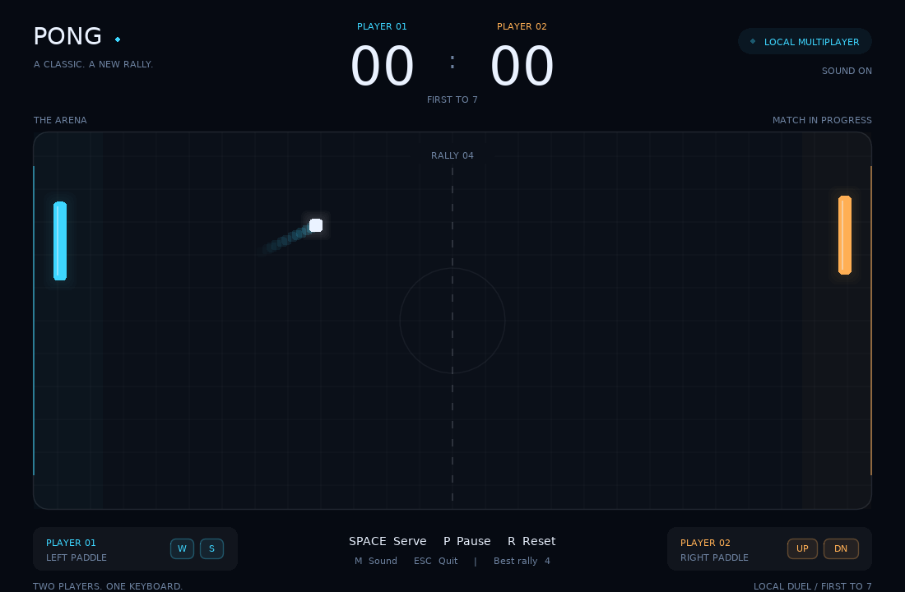
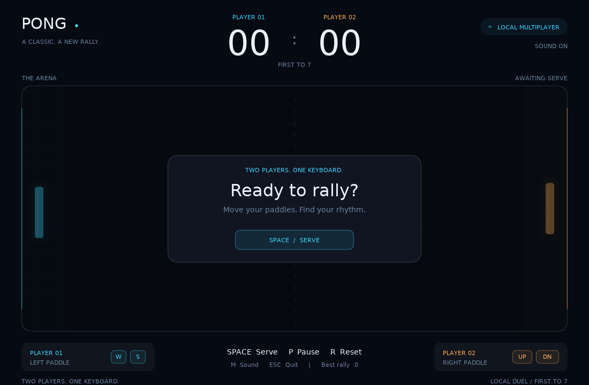
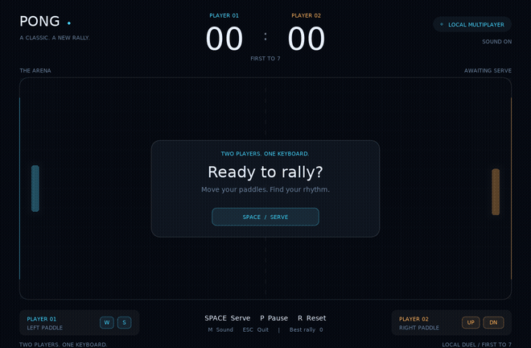

# Pong | Local Duel

A two-player Pong game written in **Lua** for **LÖVE 11.5**.

**Full name:** Ahmad Khalil

## About the game

Pong | Local Duel is a local multiplayer game for two people sharing one keyboard. Each player moves a rectangular paddle to keep a square ball in play. The ball bounces off the top and bottom walls and both paddles; missing the ball gives the opponent a point. The first player to reach seven points wins. The game uses Lua tables, keyboard polling, delta-time movement, and AABB rectangle collision detection, with a dark court, contrasting player colors, a scoreboard, ball trails, hit particles, and small synthesized sounds.

## Run

Install [LÖVE](https://love2d.org/), then open a terminal in this project folder:

```sh
love .
```

On macOS, if `love` is not in your terminal PATH, drag this project folder onto the LÖVE application. You can also run:

```sh
/Applications/love.app/Contents/MacOS/love .
```

Alternatively, open the supplied **pong-love2d.love** file with the LÖVE application. The `.love` file needs LÖVE installed; it is a packaged game, not a standalone executable. No extra Lua packages, fonts, images, or downloaded audio assets are required.

Press **Space** to serve. This is a two-human-player game; there is no computer opponent.

## Controls

| Action | Key |
| --- | --- |
| Left paddle up / down | W / S |
| Right paddle up / down | Up / Down arrows |
| Serve, resume, or start a rematch | Space or Enter |
| Pause / resume | P |
| Reset the match | R |
| Toggle sound | M |
| Save a screenshot | F12 |
| Quit | Escape |

Paddles stay inside the court. The match pauses when the window loses focus; press P or Space to resume. F12 writes `pong-screenshot.png` to LÖVE's save directory and prints the path to the console.

## My own change

The main gameplay change is **rally acceleration**: every paddle hit increases the ball's horizontal speed by **4.5%**, capped at **750 pixels per second**. This makes long rallies progressively more challenging while keeping the game playable. The vertical speed remains unchanged except for its sign when it hits a wall. I also added Space-to-serve, different paddle colors, scoring, a first-to-seven victory screen, pause/reset controls, and sound effects.

## Screenshots

Actual screenshots captured from the game running in LÖVE:





## Short demo

**[Watch or download the MP4 demo](demo/pong-demo.mp4)**

The animated preview below is included so the demo can also be viewed directly in this README:



The demo was captured from the native LÖVE game using scripted player inputs for recording. The shipped game always uses W/S and Up/Down for two human players.

## Project files

| File | Purpose |
| --- | --- |
| `main.lua` | Game state, callbacks, input, dt movement, collision, scoring, and sound |
| `ui.lua` | Court, scoreboard, paddles, ball, effects, and interface drawing |
| `conf.lua` | Window size, title, and LÖVE configuration |
| `tests/game_spec.lua` | Gameplay checks that run without a graphics window |
| `docs/EXPLANATION_AR.md` | Arabic walkthrough of the game and the key concepts |
| `docs/ASSIGNMENT_CHECKLIST.md` | Assignment requirements and where they are implemented |
| `START_HERE_AR.md` | Arabic instructions for running and submitting the project |
| `screenshots/` | Screenshots of the running game |
| `demo/` | MP4 video and animated GIF preview |

## The three callbacks

- `love.load()` runs once to create the paddles, ball, fonts, sounds, and starting state.
- `love.update(dt)` handles movement and game rules. `dt` is elapsed time in seconds, so velocity in pixels/second multiplied by `dt` gives displacement in pixels.
- `love.draw()` draws the current state by calling `ui.draw(game)`.

For example, the initial horizontal ball speed is 360 pixels/second. At 60 FPS it moves about `360 * (1/60) = 6` pixels per frame; at 30 FPS it moves 12 pixels per frame. Both cover 360 pixels in one second before any collision. The update consumes the full `dt` in small steps to reduce the risk of a fast ball passing through a paddle.

The ball is a 16-by-16 rectangle, matching the assignment's AABB rectangle collision requirement. After each paddle hit, its position is moved just outside that paddle and its horizontal velocity is reversed.

## Git history and GitHub submission

The project ZIP includes the local `.git` folder and its real commit history. The first commit is exactly:

```text
Part 1: window and paddles
```

That commit contains the working window, paddle tables, W/S and arrow-key movement, delta time, and screen boundary constraints. The following commit adds the complete game and submission files. Run `git log --oneline --reverse` to inspect the history.

Before submission:

1. Replace the two TODO fields at the top of this README with your full name and class/section.
2. Configure your Git author name and email locally if needed, then commit the README change.
3. Create an **empty public** GitHub repository named **pong-love2d**. Do not initialize it with another README, license, or `.gitignore`.
4. From this project folder, run:

```sh
git add README.md
git commit -m "Add student details"
git remote add origin https://github.com/YOUR_USERNAME/pong-love2d.git
git push -u origin main
```

Replace `YOUR_USERNAME` with your GitHub username. Use GitHub's normal authentication flow. Push this existing repository to preserve the required Part 1 commit; uploading loose files through the website does not preserve the supplied history.

The `.love` package is supplied beside the project ZIP for convenience. It is ignored by Git; the repository's Lua files are the editable source.

## Optional verification

With a Lua interpreter installed, run from the project folder:

```sh
lua tests/game_spec.lua
```

These checks exercise the real gameplay code with graphics/audio replaced by stubs. They cover controls, bounds, frame-rate consistency, collisions, ball separation, fast movement, scoring, victory, pause, reset, and focus handling. A separate LÖVE run is still needed to view the graphics and hear the sound.

## References

- [LÖVE callbacks](https://love2d.org/wiki/love)
- [love.update and delta time](https://love2d.org/wiki/love.update)
- [love.keyboard.isDown](https://love2d.org/wiki/love.keyboard.isDown)
- [love.graphics.rectangle](https://love2d.org/wiki/love.graphics.rectangle)
